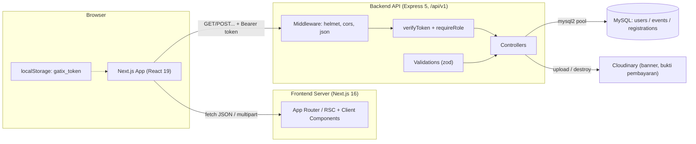
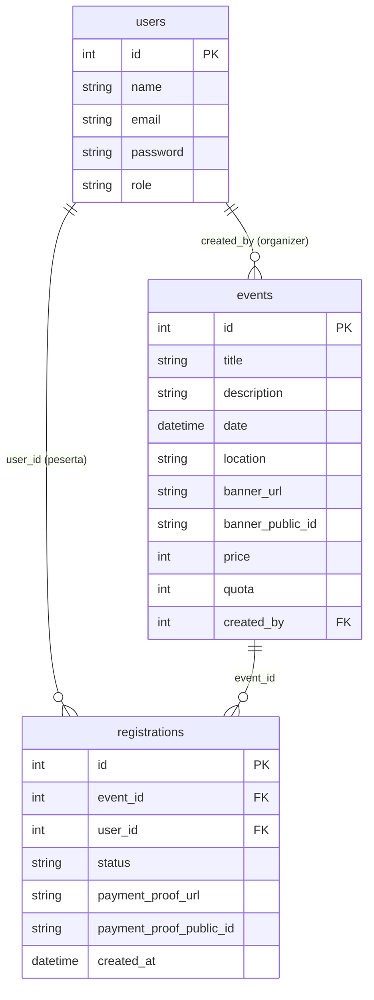

# ARCHITECTURE.md — System Architecture

> Dokumen ini menjelaskan **bagaimana GATIX dibangun dan bagaimana bagian-bagiannya terhubung**, berdasarkan kode aktual.
> Semua versi, endpoint, dan struktur diambil dari konfigurasi/kode. Hal yang tidak dapat dibuktikan ditandai `Belum terverifikasi`.
>
> Dokumentasi terkait: [`PRD.md`](./PRD.md) (kebutuhan produk), [`SYSTEM_DESIGN.md`](./SYSTEM_DESIGN.md) (desain visual), [`AGENTS.md`](./AGENTS.md) (pedoman AI agent).
>
> Dokumen API ringkas yang sudah ada: `backend/docs/API.md` (tetap dipertahankan; dokumen ini melengkapinya).

---

## 1. Technology Stack

### Frontend (`frontend/package.json`)

| Kategori | Teknologi | Versi (`package.json`) |
|---|---|---|
| Bahasa | TypeScript | `^5` |
| Framework | Next.js (App Router) | `16.4.1` |
| Library UI | React / React DOM | `19.3.0` |
| Styling | Tailwind CSS | `^4` (`@tailwindcss/postcss`) |
| Ikon | lucide-react | `^1.57.0` |
| Notifikasi | sonner | `^2.0.8` |
| Form | react-hook-form | `^7.90.0` |
| Resolver form | @hookform/resolvers | `^5.9.1` |
| Validasi | zod | `^4.6.7` |
| Lint | eslint + eslint-config-next | `^9` |

Catatan `next.config.ts`: `cacheComponents: true`, `partialPrefetching: true`, `images.remotePatterns` untuk `res.cloudinary.com`, dan rule Turbopack `@tailwindcss/turbopack`.

### Backend (`backend/package.json`)

| Kategori | Teknologi | Versi (`package.json`) |
|---|---|---|
| Bahasa | TypeScript | `^7.0.2` *(lihat catatan)* |
| Runtime | Node.js | `Belum terverifikasi` (tidak ada `engines` di `package.json`) |
| Framework | Express | `^5.2.1` |
| Database driver | mysql2 | `^3.23.3` |
| ORM | **Tidak ada** (query SQL mentah via `mysql2/promise`) | — |
| Autentikasi | jsonwebtoken | `^9.0.3` |
| Hashing | bcryptjs | `^3.0.3` |
| Validasi | zod | `^4.5.4` |
| Upload | multer | `^2.4.0` |
| Media storage | cloudinary | `^2.11.0` |
| Keamanan header | helmet | `^8.0.0` |
| CORS | cors | `^2.8.6` |
| Rate limit | express-rate-limit | `^7.5.0` |
| Env | dotenv | `^18.0.5` |
| Dev runner | tsx | `^4.23.12` |

> ⚠️ **Catatan versi:** `backend/package.json` mencantumkan `"typescript": "^7.0.2"`. Nilai ini diambil apa adanya dari konfigurasi; keberadaan rilis publik TypeScript 7 **Belum terverifikasi** — periksa saat menyiapkan environment baru.

**Database:** MySQL (nama default `db_event_ticketing`, dari `DB_NAME`). Tidak ada ORM/query builder; semua akses data lewat `mysql2/promise` pool (`backend/src/config/database.ts`).

**Komunikasi API:** REST/JSON antar frontend → backend, dengan pembungkus `api()` (`frontend/src/services/api.ts`). Upload memakai `multipart/form-data`.

**Penyimpanan file:** Cloudinary untuk banner event dan bukti pembayaran; database hanya menyimpan URL & `public_id`.

---

## 2. Project Structure

### Root

```
projectWeb/
├─ backend/     # REST API (Express + TypeScript)
├─ frontend/    # Aplikasi web (Next.js App Router)
├─ PRD.md
├─ SYSTEM_DESIGN.md
├─ ARCHITECTURE.md
└─ AGENTS.md
```

### Backend (`backend/src`)

```
src/
├─ app.ts                     # Setup Express: helmet, cors, json, routes, error handler
├─ server.ts                  # Entry point: tes koneksi DB lalu listen
├─ config/
│  ├─ env.ts                  # Baca & validasi environment variable
│  ├─ database.ts             # Connection pool mysql2/promise
│  └─ cloudinary.ts           # Konfigurasi SDK Cloudinary
├─ controllers/
│  ├─ auth.controller.ts      # register, login, me, updateMe, becomeOrganizer
│  ├─ event.controller.ts     # list, detail, create, update, remove
│  └─ registration.controller.ts # create, myTickets, detail, uploadPayment, updateStatus, listByEvent
├─ middlewares/
│  ├─ auth.ts                 # verifyToken (JWT dari header Authorization)
│  ├─ role.ts                 # requireRole(role) — hanya "organizer" yang dipakai
│  └─ upload.ts               # multer memoryStorage + fileFilter + limit 5MB
├─ routes/
│  ├─ auth.routes.ts
│  ├─ event.routes.ts
│  └─ registration.routes.ts
├─ types/express.d.ts         # Augmentasi Request: user?: { id, role }
├─ utils/upload.ts            # uploadImageToCloudinary()
└─ validations/               # Skema zod: auth.ts, event.ts, registration.ts
```

**Alasan pemisahan (disimpulkan dari kode):** pemisahan `routes → controllers → (db/cloudinary)` mengikuti pola MVC ringan. **Tidak ada layer `services/`** — controller langsung memanggil database & Cloudinary. Validasi dipisah ke `validations/` dan dipanggil di dalam controller.

### Frontend (`frontend/src`)

```
src/
├─ app/                       # Routing Next.js App Router
│  ├─ layout.tsx              # RootLayout: AuthProvider + Navbar + main + Footer + Toaster
│  ├─ globals.css             # Tailwind import + design token + body
│  ├─ page.tsx                # Beranda
│  ├─ events/                 # page.tsx (daftar), [id]/page.tsx (detail)
│  ├─ login/, register/
│  ├─ my-tickets/             # page.tsx, [id]/page.tsx
│  ├─ organizer/              # page.tsx (dashboard), events/, events/create/, events/[id]/edit/,
│  │                          # registrations/, profile/
│  └─ about/, help/, privacy/, terms/
├─ components/
│  ├─ ui/                     # Button, Input, Card, Loading, StatusBadge
│  ├─ layout/                 # Navbar, Footer, OrganizerSidebar
│  ├─ home/                   # HeroSection, SearchPanel, CategoryList, FeaturedEvents, PopularEvents, categories.ts
│  ├─ events/                 # EventCard, EventGrid, EventFilters
│  ├─ booking/                # BookingSummary, PaymentProofForm
│  └─ tickets/                # TicketCard, TicketStatus
├─ hooks/useAuth.tsx          # Context Provider autentikasi
├─ services/                  # api.ts (pembungkus fetch), auth.service.ts, event.service.ts, registration.service.ts
├─ types/                     # auth.ts, event.ts, registration.ts (tipe bersama)
├─ validators/                # auth.schema.ts, event.schema.ts (skema zod frontend)
└─ lib/utils.ts               # cn(), formatPrice(), formatDate()
```

**Catatan struktur frontend:**
- Alias `@/*` didefinisikan di `tsconfig.json` tetapi **tidak dipakai** — semua impor memakai jalur relatif (`../../services/...`). Ini konsisten di seluruh kode.
- `frontend/AGENTS.md` adalah file yang **di-generate otomatis oleh `next dev`** (blok `BEGIN:nextjs-agent-rules`). Bukan pedoman buatan manusia.

---

## 3. System Architecture



**Alur request (contoh: daftar event):**
1. Pengguna membuka `/events` — Next.js merender halaman (client component) di browser.
2. `useEffect` halaman memanggil `listEvents(query)` → `api("/events?..." )`.
3. `api()` mengambil token dari `localStorage` (bila `auth: true`), lalu `fetch` ke `${NEXT_PUBLIC_API_URL}/events?...`.
4. Express menerima → `helmet`/`cors`/`express.json` → router `event.routes` → `event.controller.list` (publik, tanpa token).
5. Controller menjalankan query SQL via pool `mysql2`, menyusun respons `{ message, data, meta }`.
6. Frontend menerima JSON → menyimpan ke state → merender `EventGrid`.
7. Error dari server (`{ message, error? }`) ditampilkan sebagai toast atau kartu error.

---

## 4. Backend Architecture

### Entry & bootstrap
- `server.ts`: memanggil tes koneksi database (`database.ts`), keluar bila gagal, lalu `app.listen(env.port)`.
- `app.ts`: `helmet()` → `cors()` → `express.json()` → router → **error handler** (4 argumen) di akhir untuk menangani error multer/umum (status 400, format `{ message }`).

### Routing
Tiga router di-mount di bawah prefix `/api/v1`:
- `auth.routes.ts` → `/api/v1/auth`
- `event.routes.ts` → `/api/v1/events`
- `registration.routes.ts` → `/api/v1/registrations`
- `GET /api/v1/health` → endpoint health sederhana.

### Controllers
Controller bertanggung jawab penuh: validasi input (via middleware zod), query database, upload Cloudinary, dan menyusun respons. **Tidak ada layer service/repository** — logika langsung berada di controller.

### Middleware
- `verifyToken` (`middlewares/auth.ts`): membaca `Authorization: Bearer <token>`, verifikasi JWT dengan `JWT_SECRET`, menyetel `req.user = { id, role }`. Token tidak valid → 401.
- `requireRole(role)` (`middlewares/role.ts`): memastikan `req.user.role === role`; dipakai dengan `requireRole("organizer")`.
- `upload` (`middlewares/upload.ts`): multer `memoryStorage`, `fileFilter` (ekstensi + mimetype jpg/jpeg/png), `limits.fileSize = 5 * 1024 * 1024`.

### Validation
Skema zod di `validations/` (`auth.ts`, `event.ts`, `registration.ts`) **dipanggil langsung di dalam controller** (`schema.safeParse(req.body)`), **bukan** sebagai middleware Express. Bila gagal, controller mengembalikan 400 dengan `{ message: "Data tidak valid", error: <daftar issue zod> }`. Skema frontend (`frontend/src/validators/`) terpisah dan hanya untuk validasi form.

### Database access
`config/database.ts` membuat pool `mysql2/promise` dari `env` (`DB_HOST`, `DB_USER`, `DB_PASS`, `DB_NAME`). Controller memakai `pool.query(...)`. **Tidak ada query builder/ORM.**

### Error handling
- Respons error standar: `{ message: string }`; khusus kegagalan validasi: `{ message: "Data tidak valid", error: [...] }`. (Endpoint auth juga menyertakan `success: false` pada sebagian respons — lihat §6.)
- Error handler global di `app.ts` menangkap `MulterError` maupun error umum dan mengembalikannya dengan status **400** beserta `{ message }`.
- **Route tidak dikenal** ditangani middleware 404 (dipasang setelah semua route) → `404 { message: "Endpoint tidak ditemukan" }`.

### Authentication & authorization (ringkas)
JWT (masa berlaku `JWT_EXPIRES_IN`) + bcryptjs. Otorisasi berbasis middleware `verifyToken` + `requireRole`, ditambah pengecekan kepemilikan di controller (mis. `created_by === req.user.id`). Rincian di §8.

---

## 5. Frontend Architecture

### Routing
Next.js App Router (berbasis folder di `src/app`). Hampir semua halaman berinteraksi dengan API dan bertanda `"use client"`. Layout global (`layout.tsx`) membungkus semua halaman dengan `AuthProvider`, `Navbar`, `main`, `Footer`, `Toaster`.

> **Penting:** `next.config.ts` mengaktifkan `cacheComponents: true`. Pada Next.js 16, komponen klien yang memakai `useParams()`/`usePathname()` **harus** dibungkus `<Suspense>` saat prerender. Batas `Suspense` ini wajib dipertahankan (lihat `AGENTS.md`).

### Component structure
- `components/ui/*` — primitif (Button, Input, Card, Loading, StatusBadge).
- `components/layout/*` — kerangka (Navbar, Footer, OrganizerSidebar).
- `components/<domain>/*` — komponen per domain fitur (home, events, booking, tickets).

### State management
- **Global:** hanya autentikasi, lewat React Context (`hooks/useAuth.tsx`) — menyimpan `user`, `loading`, serta `refresh()` dan `logout()`.
- **Lokal:** `useState` + `useEffect` per halaman untuk data (event, tiket, pendaftaran). Tidak ada Redux/Zustand/React Query.

### API client
`services/api.ts` menyediakan `api(path, options)`:
- Base URL dari `NEXT_PUBLIC_API_URL` (fallback `http://localhost:8000/api/v1`).
- Opsi `auth: true` menambahkan header `Authorization: Bearer <token>` (token dari `localStorage` key `gatix_token`).
- Bila `body` bukan `FormData`, JSON di-encode; bila `FormData`, header `Content-Type` dibiarkan agar boundary diatur browser.
- Respons non-OK → melempar `Error(message)`; 401 → token dihapus.
- Modul layanan tipis di atasnya: `auth.service.ts`, `event.service.ts`, `registration.service.ts`.

### Form handling
`react-hook-form` + `zodResolver` + skema zod frontend (`validators/auth.schema.ts`, `validators/event.schema.ts`). Form event memakai `FormData` (karena ada file banner).

### Data fetching
Semua pengambilan data terjadi di klien (`useEffect`) saat halaman dimuat; tidak ada server-side data fetching ke API. Nomor halaman/filter disimpan di state dan/atau query string.

### Error & loading handling
- Error: `toast.error(err.message)` (sonner); beberapa halaman menampilkan kartu error inline.
- Loading: komponen `Loading`, tombol `Button loading` (\"Memproses...\"), atau teks `Memuat...`.

---

## 6. API Documentation

Base URL: `${NEXT_PUBLIC_API_URL}` (default `http://localhost:8000/api/v1`). Semua endpoint berawalan `/api/v1`.
Autentikasi: header `Authorization: Bearer <token>`. `Auth` = wajib login; `Role` = role yang diizinkan.

### Auth — `backend/src/routes/auth.routes.ts`

| Method | Endpoint | Fungsi | Body / Param | Auth | Role | Respons penting |
|---|---|---|---|---|---|---|
| POST | `/auth/register` | Registrasi akun baru | `{ name, email, password }` | Tidak | — | 201 · `{ success: true, message, data: { id, name, email, role }, token }` |
| POST | `/auth/login` | Login | `{ email, password }` | Tidak | — | 200 · `{ success: true, message, token, data: user }` |
| GET | `/auth/me` | Ambil user saat ini | — | Ya | semua | `{ message: "Fetch Successfully.", data: { id, name, email, role } }` |
| PATCH | `/auth/me` | Ubah nama profil | `{ name }` | Ya | semua | `{ message, data: user }` |
| POST | `/auth/become-organizer` | Ubah role jadi organizer | — | Ya | semua | `{ message, data: user, token }` |

> Catatan format: `token` dikembalikan **di level atas** (bukan di dalam `data`), dan field `success` hanya ada pada `register`/`login` (tidak ada pada `me`, `updateMe`, `become-organizer`). Ini inkonsistensi nyata pada kode saat ini.

`POST /auth/login` dibatasi **rate limit 20 percobaan / 15 menit**.

### Events — `backend/src/routes/event.routes.ts`

| Method | Endpoint | Fungsi | Body / Query | Auth | Role | Respons penting |
|---|---|---|---|---|---|---|
| GET | `/events` | Daftar event (filter + paginasi) | Query: `search, location, date_from, date_to, sort_by(date\|price), order(asc\|desc), page, limit` (default `limit` = 12, maks 50) | Tidak | — | `{ message, data: EventItem[], pagination: { page, limit, total, totalPages } }` |
| GET | `/events/:id` | Detail event | — | Tidak | — | `{ message, data: EventItem }` |
| POST | `/events` | Buat event | `multipart/form-data`: `title, description, date, location, price, quota, banner?` | Ya | organizer | `{ message, data: EventItem }` (201) |
| PATCH | `/events/:id` | Ubah event | `multipart/form-data` (field opsional + `banner?`) | Ya | organizer (pemilik) | `{ message, data: EventItem }` |
| DELETE | `/events/:id` | Hapus event + registrasi + aset Cloudinary | — | Ya | organizer (pemilik) | `{ message }` |
| GET | `/events/:id/registrations` | Daftar pendaftar sebuah event | — | Ya | organizer (pemilik) | `{ message, data: Registration[] }` |

### Registrations — `backend/src/routes/registration.routes.ts`

| Method | Endpoint | Fungsi | Body | Auth | Role | Respons penting |
|---|---|---|---|---|---|---|
| POST | `/registrations` | Daftar ke event | `{ event_id }` | Ya | semua | `{ message, data: Registration }` (201) |
| GET | `/registrations/my-tickets` | Tiket milik user | — | Ya | semua | `{ message, data: Registration[] }` |
| GET | `/registrations/:id` | Detail tiket | — | Ya | pemilik / organizer pemilik event | `{ message, data: Registration }` |
| PATCH | `/registrations/:id/payment` | Unggah bukti pembayaran | `multipart/form-data`: `payment_proof` | Ya | pemilik tiket (status pending) | `{ message, data }` |
| PATCH | `/registrations/:id/status` | Ubah status (`approved`/`cancelled`) | `{ status }` | Ya | pemilik (cancel) / organizer pemilik event (approve/cancel) | `{ message, data: Registration }` |

### Health

| Method | Endpoint | Fungsi | Auth |
|---|---|---|---|
| GET | `/api/v1/health` | Cek server hidup | Tidak |

> Detail tambahan (contoh respons, catatan) tersedia di `backend/docs/API.md`.
> Route API yang tidak terdaftar mengembalikan `404 { message: "Endpoint tidak ditemukan" }`.

---

## 7. Database Design

> ⚠️ **Penting:** **tidak ada file skema SQL/migration di repository** (tidak ditemukan file `.sql`, tidak ada tool migration). Struktur di bawah **disimpulkan dari query SQL aktual** di controller. Tipe data, constraint DB, dan index **Belum terverifikasi** (tidak bisa dipastikan tanpa skema asli).
>
> **Rekomendasi:** tambahkan skema/migration ter-versioning agar struktur table dapat dipastikan (lihat §11).

### Tabel (disimpulkan dari query)

**`users`**
| Kolom | Keterangan |
|---|---|
| `id` | Primary key (dipakai di `SELECT id`, JWT payload) |
| `name` | Nama (dipakai & diubah lewat `PATCH /auth/me`) |
| `email` | Unik (dicek `WHERE email = ?`) |
| `password` | Hash bcrypt |
| `role` | `'user'` / `'organizer'` (nilai aktual di kode) |

*Kolom lain (mis. `created_at`): Tidak terlihat dipilih pada query manapun — `Belum terverifikasi`.*

**`events`**
| Kolom | Keterangan |
|---|---|
| `id` | Primary key |
| `title`, `description`, `date`, `location` | Data event |
| `banner_url` | URL Cloudinary |
| `banner_public_id` | ID Cloudinary (untuk hapus aset) |
| `price` | Harga (0 = gratis) |
| `quota` | Kuota |
| `created_by` | FK → `users.id` (pemilik event) |

**`registrations`**
| Kolom | Keterangan |
|---|---|
| `id` | Primary key |
| `event_id` | FK → `events.id` |
| `user_id` | FK → `users.id` |
| `status` | `'pending'` / `'approved'` / `'cancelled'` |
| `payment_proof_url` | URL Cloudinary bukti pembayaran |
| `payment_proof_public_id` | ID Cloudinary |
| `created_at` | Dipakai `ORDER BY r.created_at DESC` |

### Relasi (disimpulkan)



- **Foreign key** ditandai berdasarkan makna kolom; constraint DB aktual `Belum terverifikasi`.
- **Kuota** bukan kolom, melainkan dihitung: `COUNT(status IN ('pending','approved'))`.
- **Integritas kuota & anti-duplikat** dijaga di level aplikasi memakai transaksi `SELECT ... FOR UPDATE`, bukan constraint database.

---

## 8. Authentication and Authorization

### Alur autentikasi
1. `POST /auth/register` atau `POST /auth/login` memverifikasi kredensial, lalu menerbitkan JWT bertanda tangan `JWT_SECRET` (payload berisi `id` dan `role`), berlaku `JWT_EXPIRES_IN`.
2. Frontend menyimpan token di `localStorage` (`gatix_token`) dan mengirimnya sebagai `Authorization: Bearer <token>` saat `auth: true`.
3. `verifyToken` memverifikasi token dan menyetel `req.user`.
4. `GET /auth/me` dipakai `AuthProvider` saat aplikasi dimuat untuk memuat `user`; bila token tidak valid, token dihapus dan `user` menjadi null.
5. `logout()` di frontend menghapus token dari `localStorage` (tidak ada endpoint server untuk logout).

### Manajemen token/session
- **Tanpa session server**; seluruhnya stateless JWT.
- Tidak ada refresh token — setelah kedaluwarsa, pengguna harus login ulang.
- `become-organizer` menerbitkan **token baru** karena `role` ikut di dalamnya.

### Pembatasan akses
- `verifyToken` — wajib login.
- `requireRole("organizer")` — hanya role organizer (dipakai di route event tulis & daftar pendaftar).
- **Pengecekan kepemilikan** di controller: event hanya bisa diubah/dihapus/didaftar pendaftarannya oleh `created_by === req.user.id`; registrasi hanya bisa dilihat/dibatalkan pemiliknya, dan status hanya bisa diubah organizer pemilik event terkait.

---

## 9. External Services and Environment

### Layanan eksternal
| Layanan | Fungsi | Konfigurasi |
|---|---|---|
| **MySQL** | Penyimpanan data utama | `DB_HOST`, `DB_USER`, `DB_PASS`, `DB_NAME` |
| **Cloudinary** | Penyimpanan banner event & bukti pembayaran | `CLOUDINARY_CLOUD_NAME`, `CLOUDINARY_API_KEY`, `CLOUDINARY_API_SECRET` |

### Environment variable

**Backend** (`backend/.env`, contoh di `backend/.env.example`):
`PORT`, `CORS_ORIGIN`, `DB_HOST`, `DB_USER`, `DB_PASS`, `DB_NAME`, `CLOUDINARY_CLOUD_NAME`, `CLOUDINARY_API_KEY`, `CLOUDINARY_API_SECRET`, `JWT_SECRET`, `JWT_EXPIRES_IN`.

**Frontend** (`frontend/.env.local`, contoh di `frontend/.env.example`):
`NEXT_PUBLIC_API_URL` (contoh: `http://localhost:8000/api/v1`).

> 🔒 **Jangan menuliskan nilai rahasia** ke dokumentasi/repositori. `backend/.env.example` hanya berisi **placeholder** — nilai asli diisi di `backend/.env` (di-ignore git). Berdasarkan pemeriksaan git, `frontend/.env.local` **tidak** terlacak git (di-ignore `.env*`), sehingga `frontend/.env.example` juga **tidak** ikut ter-commit — environment baru perlu membuatnya manual.

### Menjalankan project

**Backend:**
```bash
cd backend
npm install
# buat .env (lihat bagian Environment variable di atas)
npm run dev        # tsx watch src/server.ts
```
Script lain (dari `backend/package.json`): `build` (`tsc`), `start` (`node dist/server.js`), `typecheck` (`tsc --noEmit`).

**Frontend:**
```bash
cd frontend
npm install
# buat .env.local berisi NEXT_PUBLIC_API_URL
npm run dev        # next dev
```
Script lain: `build` (`next build`), `start` (`next start`), `lint` (`eslint`).

> Catatan konfigurasi dev/prod: backend default `PORT=8000`; frontend default API URL `http://localhost:8000/api/v1`. Tidak ada konfigurasi khusus production lain (mis. reverse proxy) di repo — `Belum terverifikasi`.

---

## 10. Data Flow and Dependencies

### Alur data fitur utama

**Mendaftar event** (`registration.controller.create`):
```
POST /registrations (verifyToken)
  → validasi zod (event_id)
  → BEGIN transaction
    → SELECT event ... FOR UPDATE
    → COUNT registrations pending/approved  → cek kuota
    → cek registrasi user untuk event ini
      - ada & cancelled → reaktivasi (status = price===0 ? approved : pending)
      - ada & aktif     → tolak (duplikat)
      - belum ada       → INSERT (status = price===0 ? approved : pending)
  → COMMIT
  → respons
```

**Unggah bukti pembayaran** (`registration.controller.uploadPayment`):
```
PATCH /registrations/:id/payment (verifyToken + multer)
  → cek registrasi milik user & status pending
  → upload buffer ke Cloudinary (utils/upload.ts)
  → hapus bukti lama bila ada (destroy public_id lama)
  → UPDATE registrations SET payment_proof_url, payment_proof_public_id
  → respons
```

**Verifikasi organizer** (`registration.controller.updateStatus`):
```
PATCH /registrations/:id/status (verifyToken)
  → muat registrasi + event
  → tentukan izin: pemilik tiket (hanya cancel) atau organizer pemilik event
  → bila approve: cek kuota
  → UPDATE status
  → respons
```

**Hapus event** (`event.controller.remove`):
```
DELETE /events/:id (verifyToken + requireRole organizer)
  → cek created_by === req.user.id
  → hapus aset Cloudinary (banner + semua bukti pembayaran pendaftar)
  → DELETE registrations WHERE event_id
  → DELETE event
```

### Ketergantungan antar modul

| Perubahan pada… | Perlu diperiksa… |
|---|---|
| Skema/kolom tabel | Semua controller (`auth`, `event`, `registration`) + tipe frontend (`types/*`) |
| Kontrak API (nama field/status) | `services/*.service.ts`, `types/*`, halaman yang mengonsumsi |
| Perubahan `role` | `middlewares/role.ts`, `auth.controller.ts`, `Navbar`, `useAuth`, halaman organizer |
| Perubahan aturan kuota/status | `registration.controller.ts` (create, updateStatus), `StatusBadge`, `TicketStatus` |
| Perubahan field event | `validations/event.ts` + `validators/event.schema.ts` + form create/edit + `types/event.ts` |
| Perubahan warna/komponen UI | `SYSTEM_DESIGN.md` dan `components/ui/*` |
| Perubahan konfigurasi Next | `next.config.ts` (Suspense, images, cacheComponents) |

---

## 11. Technical Limitations

**Keterbatasan arsitektur yang ditemukan:**

1. **Skema database tidak ter-version.** Tidak ada `.sql`/migration; pemulihan/replikasi struktur bergantung pada database yang sudah ada. (Risiko tertinggi untuk onboarding & deploy.)
2. **Token JWT disimpan di `localStorage`** → rentan terhadap XSS; tidak ada refresh token.
3. **CORS `cors()` tanpa opsi** → mengizinkan origin apa pun (nyaman untuk dev, berisiko di production).
4. **Tidak ada 404 handler JSON** → route salah mengembalikan HTML default Express, tidak konsisten dengan format `{ message }`.
5. **Tidak ada layer service** → logika bisnis menumpuk di controller; query SQL tersebar (sulit diuji).
6. **Media Cloudinary bersifat publik** — URL tidak bertanda tangan; siapa pun yang memiliki URL dapat mengakses bukti pembayaran. Teks `/privacy` sudah diselaraskan (bukti hanya ditampilkan ke pemilik tiket & organizer), namun akses publik via URL masih mungkin. Solusi (signed/authenticated delivery) dicatat sebagai rekomendasi.
7. **Kredensial asli pernah ter-commit.** Nilai asli Cloudinary & `JWT_SECRET` sebelumnya ada di `backend/.env.example` dan **masih tersimpan di riwayat git**. Berkas contoh kini memakai placeholder, tetapi nilai lama perlu **dirotasi** (ganti API key/secret Cloudinary dan `JWT_SECRET`). Nilai tidak dicantumkan di dokumen ini.
8. **Dashboard organizer memuat pendaftaran secara berurutan** (`for ... await`) untuk 10 event pertama → lambat bila data banyak.
9. **Halaman organizer events tanpa paginasi** (`limit: 50`).
10. **Tidak ada test otomatis** (script `test` hanya placeholder) dan tidak ada CI.
11. **Pengecekan "tanggal harus masa depan" hanya saat create**, tidak saat update.
12. **Tidak ada validasi jenis konten dari sisi server selain multer** untuk file banner selain ekstensi/mimetype — perlu pengecekan lanjutan bila ingin lebih ketat. *(Sebagian terverifikasi: ada `fileFilter` ekstensi + mimetype.)*

**Potensi masalah teknis lain:** ketergantungan pada `cacheComponents`/`Suspense` pada Next 16 (mudah rusak saat refactor); `typescript@^7.0.2` perlu diverifikasi; tidak ada `.nvmrc`/`engines` sehingga versi Node tidak dipatok.

> **Rekomendasi (terpisah dari kondisi aktual — jangan diterapkan tanpa persetujuan):** migration DB; pindahkan token ke httpOnly cookie + refresh token; batasi CORS ke origin frontend; tambah 404 handler JSON; hapus kredensial asli dari `.env.example` (ganti placeholder) dan rotasi kredensial yang bocor; signed URL Cloudinary; layer service untuk logika kompleks; paginasi & `Promise.all` di organizer; test otomatis + CI.

---

*Dokumen ini mencerminkan kondisi pada commit `0324a4f`. Perbarui bila teknologi, API, database, atau alur sistem berubah (lihat `AGENTS.md` §Documentation Maintenance).*
