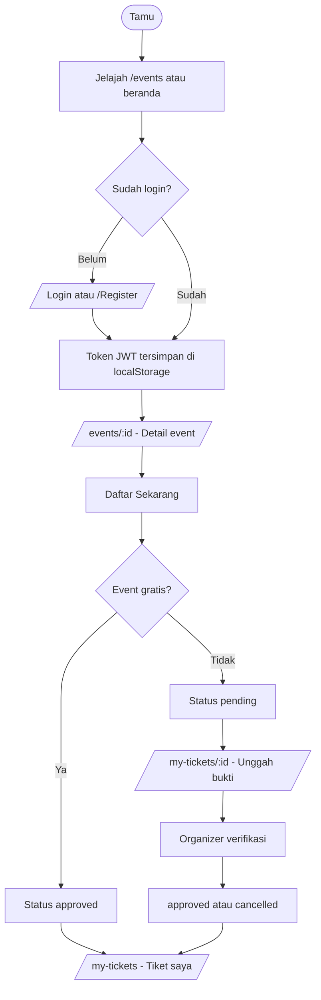
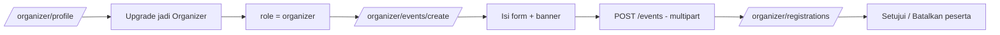

# PRD.md — Product Requirements Document

> Dokumen ini mendokumentasikan **kondisi aktual** aplikasi GATIX yang sudah dibangun, bukan rancangan produk baru.
> Semua pernyataan diambil dari kode sumber. Hal yang tidak dapat dibuktikan ditandai `Belum diketahui` / `Belum terverifikasi`.
>
> Dokumentasi terkait: [`ARCHITECTURE.md`](./ARCHITECTURE.md) (cara sistem dibangun), [`SYSTEM_DESIGN.md`](./SYSTEM_DESIGN.md) (desain visual), [`AGENTS.md`](./AGENTS.md) (pedoman AI agent).

---

## 1. Product Overview

| Aspek | Keterangan | Bukti |
|---|---|---|
| Nama produk | **GATIX** | `frontend/src/app/layout.tsx` (`title: "GATIX - Event Ticketing Platform"`), `backend/package.json` (`name: "gatix-backend"`) |
| Jenis produk | Marketplace / platform event ticketing | `frontend/src/components/home/HeroSection.tsx` (label "EVENT TICKETING MARKETPLACE") |
| Tujuan | Membantu pengguna menemukan event dan mengamankan tiket; membantu organizer membuat & mengelola event serta memverifikasi pembayaran | `frontend/src/app/about/page.tsx`, `frontend/src/app/help/page.tsx` |

**Masalah yang ingin diselesaikan (berdasarkan teks UI aktual):**

- Pengguna kesulitan menemukan event relevan → disediakan pencarian, kategori, filter lokasi/tanggal, dan daftar "event di sekitarmu".
- Pendaftaran & pembayaran tiket manual perlu alur yang jelas → event gratis langsung disetujui, event berbayar memakai unggah bukti pembayaran dan verifikasi organizer.

**Target pengguna:**

1. **Tamu (guest)** — pengunjung yang belum login, hanya bisa menjelajah.
2. **User (peserta)** — pendaftar event dan pemegang tiket.
3. **Organizer** — pembuat & pengelola event.

**Nilai utama:**

- Penemuan event cepat (pencarian, kategori, lokasi, urut harga/tanggal).
- Alur pendaftaran sederhana dengan status tiket yang transparan (`pending` / `approved` / `cancelled`).
- Organizer punya dashboard untuk mengelola event dan memverifikasi bukti pembayaran.

---

## 2. Business Process

Alur bisnis utama (dari sisi pengguna hingga data tersimpan):

1. **Akuisisi & jelajah** — Tamu membuka `/`, mencari event lewat hero search, kategori, atau halaman `/events` (filter + paginasi). Data event dibaca dari tabel `events` (join `users` untuk nama organizer).
2. **Registrasi akun** — Pengguna mendaftar di `/register`. Backend `POST /api/v1/auth/register` memvalidasi (zod), cek email unik, hash password (bcrypt, cost 10), menyimpan ke tabel `users` dengan `role = 'user'`, lalu mengembalikan JWT.
3. **Login** — `POST /api/v1/auth/login` memverifikasi password, mengembalikan JWT (masa berlaku dari `JWT_EXPIRES_IN`). Token disimpan di `localStorage` browser dengan key `gatix_token`.
4. **Pendaftaran event** — Dari `/events/[id]`, pengguna menekan "Daftar Sekarang". `POST /api/v1/registrations` menjalankan transaksi:
   - kunci baris event (`SELECT ... FOR UPDATE`),
   - cek kuota (`COUNT` registrasi `pending`/`approved` < `quota`),
   - cek duplikasi (1 user 1 registrasi per event),
   - menentukan status: **gratis → `approved`**, **berbayar → `pending`**.
5. **Pembayaran manual (event berbayar)** — Pengguna mengunggah bukti di `/my-tickets/[id]` via `PATCH /api/v1/registrations/:id/payment` (multipart, jpg/png ≤ 5 MB). File diunggah ke **Cloudinary**, URL & `public_id` disimpan di tabel `registrations`.
6. **Verifikasi organizer** — Organizer membuka `/organizer/registrations`, melihat daftar peserta + bukti, lalu `PATCH /api/v1/registrations/:id/status` (`approved`/`cancelled`). Approve dicek terhadap kuota.
7. **Tiket** — Pengguna melihat tiket di `/my-tickets` (filter status) & detail di `/my-tickets/[id]`, bisa membatalkan (`cancelled`) yang membebaskan kuota.
8. **Menjadi organizer** — Dari `/organizer/profile`, `POST /api/v1/auth/become-organizer` mengubah `role` menjadi `organizer` dan menerbitkan token baru.
9. **Kelola event** — Organizer membuat/mengubah/menghapus event (banner ke Cloudinary). Menghapus event juga menghapus registrasi terkait dan aset Cloudinary-nya (`event.controller.ts`).

**Bagaimana data diproses & disimpan:**

- **Database MySQL** (nama dari `DB_NAME`, default `db_event_ticketing`) dengan 3 tabel: `users`, `events`, `registrations`. Diakses lewat `mysql2/promise` (connection pool) langsung dari controller (tidak ada ORM/layer service).
- **Aset gambar** (banner event, bukti pembayaran) disimpan di **Cloudinary**; database hanya menyimpan `*_url` dan `*_public_id`.

**Dukungan frontend ↔ backend:**

- Frontend (Next.js App Router) memanggil REST API backend lewat pembungkus `api()` di `frontend/src/services/api.ts` (base URL `NEXT_PUBLIC_API_URL`). Semua request data dilakukan di sisi klien (`"use client"` + `useEffect`).

---

## 3. User Roles

Role yang **benar-benar ada** di kode: `user` dan `organizer` (`backend/src/middlewares/role.ts`, `requireRole(...)`; `backend/src/controllers/auth.controller.ts`). **Tidak ada role `admin`** di backend aktual (meskipun template lama `belajarExpress2` memilikinya).

| Role | Cara didapat | Hak akses |
|---|---|---|
| **Tamu (belum login)** | — | `GET /events`, `GET /events/:id` (publik). Melihat halaman statis. Tidak dapat mendaftar/mengunggah. |
| **user** | Otomatis saat registrasi publik | Semua akses tamu + `GET/PATCH /auth/me`, `POST /become-organizer`, `POST /registrations`, `GET /registrations/my-tickets`, `GET /registrations/:id` (miliknya/organizer event), `PATCH /registrations/:id/payment` (tiketnya, status `pending`), `PATCH /registrations/:id/status` **hanya** untuk membatalkan tiket sendiri. |
| **organizer** | `POST /auth/become-organizer` (user yang sudah login) | Semua akses user + `POST/PATCH/DELETE /events` (hanya event miliknya), `GET /events/:id/registrations` (hanya event miliknya), approve/cancel pendaftaran pada event miliknya. |

> Catatan: organizer yang **bukan** pemilik sebuah event ditolak (403) saat mencoba mengubah status pendaftaran event itu (`registration.controller.ts`).

---

## 4. Features

Status: **Selesai** = ada implementasi backend + frontend dan terhubung; **Sebagian** = ada tapi ada batasan; **Belum terverifikasi** = ada kode namun perilaku runtime belum diuji end-to-end.

| # | Fitur | Fungsi | Alur singkat | Status |
|---|---|---|---|---|
| 1 | Registrasi akun | Membuat akun `user` | `/register` → `POST /auth/register` | Selesai |
| 2 | Login & sesi | Autentikasi JWT | `/login` → `POST /auth/login` → token di `localStorage` | Selesai |
| 3 | Logout | Hapus token lokal | Menu akun → `clearToken()` | Selesai |
| 4 | Jelajah event | Daftar + filter + paginasi | `/events` → `GET /events?search&location&date_from&date_to&sort_by&order&page&limit` | Selesai |
| 5 | Detail event & booking | Lihat detail + daftar | `/events/[id]` → `GET /events/:id`, `POST /registrations` | Selesai |
| 6 | Pencarian beranda | Hero search + "cari event di sekitarmu" (berdasar kota) | `/` → `GET /events` | Selesai |
| 7 | Kategori | Grid 6 kategori → pencarian keyword | `CategoryList` → `/events?search=<keyword>` | Sebagian (lihat catatan) |
| 8 | Upload bukti pembayaran | Unggah bukti (jpg/png ≤5 MB) | `/my-tickets/[id]` → `PATCH /registrations/:id/payment` | Selesai |
| 9 | Tiket saya | Daftar tiket + tab status + detail + batal | `/my-tickets`, `/my-tickets/[id]` | Selesai |
| 10 | Ubah profil | Ubah nama | `/organizer/profile` → `PATCH /auth/me` | Selesai |
| 11 | Upgrade organizer | Ubah role jadi organizer | `/organizer/profile` → `POST /auth/become-organizer` | Selesai |
| 12 | Dashboard organizer | Total event/peserta + pendaftaran menunggu | `/organizer` → `GET /events`, `GET /events/:id/registrations` | Selesai |
| 13 | CRUD event | Buat/ubah/hapus event + banner | `/organizer/events*` → `POST/PATCH/DELETE /events` | Selesai |
| 14 | Manajemen pendaftaran | Setujui/batalkan peserta | `/organizer/registrations` → `PATCH /registrations/:id/status` | Selesai |
| 15 | Halaman statis | Tentang, Bantuan (FAQ), Privasi, Syarat | `/about`, `/help`, `/privacy`, `/terms` | Selesai |
| 16 | Notifikasi toast | Feedback sukses/gagal | `sonner` `Toaster` di layout | Selesai |

**Catatan fitur #7 (Kategori):** tabel `events` **tidak punya kolom kategori**. Kategori hanya menjalankan pencarian teks (`/events?search=musik`, dst.) lewat `CATEGORIES` di `frontend/src/components/home/categories.ts`. Selain itu, field `category` pada `EventFilters` bersifat **UI-only** — tidak dikirim ke API (`events/page.tsx` tidak meneruskan `category`).

---

## 5. Business Rules

Aturan yang **diterapkan di kode**:

**Akun & autentikasi**
- Registrasi publik selalu menghasilkan `role = 'user'`.
- Email harus unik (`SELECT id FROM users WHERE email = ?`).
- Password minimum 6 karakter; nama minimum 3 karakter (zod: `backend/src/validations/auth.ts`, `frontend/src/validators/auth.schema.ts`).
- Password di-hash `bcrypt` dengan cost 10.
- Login dibatasi **rate limit 20 percobaan / 15 menit** (`auth.routes.ts`).
- JWT dikirim via header `Authorization: Bearer <token>`; secret wajib ada (`env.ts` `required("JWT_SECRET")`).

**Event**
- `title` min 3 / maks 150, `description` min 1, `date` harus valid, `location` min 1 / maks 255, `price` ≥ 0, `quota` ≥ 1.
- Saat **create**, tanggal event harus di masa depan (toleransi 60 detik).
- Saat **update**, tanggal valid dicek, tetapi **tidak** ada pengecekan "harus masa depan" (perbedaan dari create).
- Hanya `organizer` dan **hanya pemilik** (`created_by`) yang boleh ubah/hapus event dan melihat pendaftarannya.
- Menghapus event menghapus registrasi terkait dan aset Cloudinary (banner + bukti pembayaran).

**Pendaftaran & kuota**
- Kuota = jumlah registrasi `pending` + `approved`; bila ≥ `quota` → ditolak.
- Satu user hanya boleh punya satu registrasi per event.
- Registrasi berstatus `cancelled` dapat **diaktifkan kembali** (bukan baris ganda).
- **Event gratis** (`price = 0`) → langsung `approved`. **Event berbayar** → `pending`.
- Pengecekan kuota & anti-duplikat dijalankan dalam **transaksi** dengan `SELECT ... FOR UPDATE`.

**Bukti pembayaran**
- Hanya pemilik tiket, dan hanya saat status `pending`.
- Format jpg/jpeg/png, maksimum 5 MB.
- Mengunggah bukti **tidak** otomatis menyetujui tiket.

**Pembatalan**
- User dapat membatalkan tiketnya sendiri (status `pending`/`approved`).
- Organizer pemilik event dapat menyetujui/membatalkan.

---

## 6. User Flow

### End-to-end

### Menjadi organizer & membuat event

---

## 7. Current Limitations

Berdasarkan bukti kode (bukan asumsi):

1. **Tidak ada file skema/migration database di repo.** Tidak ditemukan file `.sql` maupun tool migration. Struktur tabel hanya bisa disimpulkan dari query (lihat `ARCHITECTURE.md` §Database Design). Menyiapkan database baru = manual.
2. **Pembayaran sepenuhnya manual** — tidak ada payment gateway/integrasi pembayaran; verifikasi oleh organizer.
3. **Tidak ada fitur lupa password / reset password.**
4. **Tidak ada role admin** dan tidak ada halaman khusus admin.
5. **Kategori tidak tersimpan di data event** — hanya pencarian teks.
6. **Tidak ada endpoint untuk mengubah/menghapus akun** (hanya `PATCH /auth/me` untuk nama).
7. **Kuota bersifat real-time per request** — tidak ada indikator live/websocket.
8. **`/organizer/events` memuat maksimum 50 event tanpa paginasi** (`listEvents({ limit: 50 })`).
9. **Dashboard organizer memuat pendaftaran 10 event pertama secara berurutan** (`for ... await`), sehingga lebih lambat bila event banyak.
10. **Klaim privasi vs implementasi:** halaman `/privacy` menyatakan "Bukti pembayaran hanya dapat dilihat oleh organizer pemilik event", tetapi URL Cloudinary bersifat publik (siapa pun yang punya URL dapat membukanya). Lihat juga `ARCHITECTURE.md` §Technical Limitations.
11. Klaim `Belum terverifikasi`: perilaku runtime penuh (termasuk transaksi kuota bersamaan) **belum diuji end-to-end** karena tidak ada test otomatis dan environment DB/Cloudinary belum dijalankan dalam proses dokumentasi ini.

---

## 8. Future Improvements

> Bagian ini **rekomendasi**, bukan fitur yang sudah ada.

- **Skema database ter-version** (file `.sql` atau migration) agar setup & perubahan skema dapat dilacak.
- **Reset password** (mis. via email/token sekali pakai).
- **Kategori sebagai kolom `events.category`** + filter server-side, bukan pencarian teks.
- **Payment gateway** (mis. Midtrans/Xendit) untuk verifikasi otomatis.
- **Paginasi** di halaman event organizer dan dashboard yang lebih efisien (`Promise.all`).
- **Indikator kuota real-time** atau refresh berkala.
- **Proteksi URL media** (signed/authenticated Cloudinary URL) sesuai klaim privasi.
- **Role admin** bila diperlukan moderasi (belum ada sekarang).
- **Test otomatis** (mis. Vitest/Jest untuk backend, Playwright untuk alur utama).

---

*Dokumen ini menggambarkan kondisi saat commit `0324a4f`. Perbarui bila fitur bisnis berubah (lihat `AGENTS.md` §Documentation Maintenance).*
